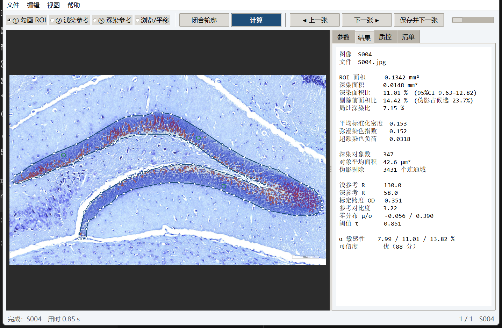

# NisslQuant

**尼氏染色深染面积半自动化定量工具**  
Semi-automated quantification of dark-stained area in Nissl-stained sections

NisslQuant 用"同片双参考光密度标定 + 多尺度密度分解 + 错误率控制阈值"测量尼氏染色切片中的深染面积比，
并给出逐张的 95% 置信区间与质控分级。它面向海马齿状回颗粒层这类分层结构，也可用于其他单色碱性染料切片。

> 本仓库只包含代码与一张**合成**演示图像，不包含任何真实动物实验数据。

---

## 为什么需要它

尼氏染色的"深染"是一个连续、边界模糊、随染色批次变化的表观量。通用图像软件（ImageJ、QuPath、HALO 等）
只能用绝对灰度阈值分割，换一张切片、换一次曝光就要重调阈值；同一批图像用不同"合理"的阈值，
深染面积比可以相差数倍。

NisslQuant 把阈值从"人为设定的灰度值"改成"由浅染参考区零分布与单侧错误率决定的统计量"，
并把"整片偏深"与"局部深斑"分成两个尺度分别报告。

## 方法要点

1. **两点光密度标定**  
   `OD = −lg[(I−b)/(I₀−b)]`，`u = (OD−OD_L)/(OD_D−OD_L)`  
   u=0 对应浅染参考，u=1 对应深染参考。比值形式吸收曝光的整体缩放。

2. **多尺度密度分解**  
   `u_s = G_σ × u`，`u_f = u − u_s`  
   u_s 为弥漫染色，u_f 为相对于局部背景的深斑。

3. **错误率阈值**  
   `τ = μ₀ + z(1−α)·σ₀`，μ₀ 与 σ₀ 由浅染参考区的中位数与 MAD 稳健估计。  
   由于标定与零分布同源，**参考点位置移动时阈值同步作仿射变换，深染像素集合不变**。

4. **伪影剔除与不确定度**  
   连通域面积、贴边比例、过饱和比例、长宽比/实心度四条规则剔除伪影；
   对象级 bootstrap 给出 95% 置信区间；参考对比度、双峰系数等五项指标输出质控分级。

## 安装

需要 Python 3.10+。

```bash
git clone https://github.com/YOUR_GITHUB_USERNAME/nisslquant.git
cd nisslquant
pip install -r requirements.txt
```

不装 Python 也可以：从 [Releases](../../releases) 下载 `NisslQuant.exe`（Windows 10/11，单文件免安装）。

## 快速开始

### 图形界面

```bash
python main.py
```

1. `文件 → 打开文件夹`，载入图像；
2. 「① 勾画 ROI」沿颗粒层外缘逐点单击，Enter 闭合；
3. 「② 浅染参考」在浅色神经毡处点 1–3 下；
4. 「③ 深染参考」在深色斑块处点 1–3 下；
5. 点「计算」，查看叠加图、结果与质控；
6. 「保存并下一张」，全部完成后导出 CSV 与 HTML 报告。



### 演示数据（合成图像）

```bash
python examples/make_demo.py          # 生成 demo_nissl.png 与 demo_points.json
python examples/run_demo.py           # 跑一遍并输出指标与叠加图
```

### 命令行批处理

```bash
python main.py --cli --project batch.nqproj --out results.csv --report
```

可选参数：`--alpha 0.01`、`--sigma 35`、`--um 0.4975`。

## 输出指标

| 指标 | 含义 |
|---|---|
| `daf_pct` | 深染面积比（伪影剔除后），主指标 |
| `daf_raw_pct` | 剔除前的阈值面积比 |
| `dark_mm2` | 绝对深染面积 |
| `focal_pct` | 局灶深染比（u_f 超阈面积占比） |
| `mean_u` / `diffuse_u` / `excess_load` | 连续指标，不依赖硬阈值 |
| `ci_low` / `ci_high` | 对象级 bootstrap 95% 置信区间 |
| `qc_grade` / `qc_flags` | 优 / 良 / 可疑 / 不合格，及具体告警 |

## 方法学验证

在 44 张 20× 小鼠海马齿状回切片上，与"两点中点阈值 + 3×3 开运算"的常规流程对比：

| 扰动 | 常规流程 | NisslQuant |
|---|---|---|
| 参考点 ±15 px 随机抖动 | DAF 变异系数 54.8% | **0** |
| 阈值 ±20 灰度 / α 0.005–0.02 | 峰-峰相对变化 131.5% | **31.2%** |
| ROI 边界 ±5 px | 8.8% | **5.5%** |

两种方法的 DAF 相关系数 0.813，Bland–Altman 偏倚 −4.21 个百分点；单张处理约 0.9 s。
详见待发表论文（见下方引用）。

## 已知局限

- 深染面积是**面积积分**，不等于深染细胞计数；
- 深染成分不唯一（正常尼氏体密集区、皱缩的暗神经元、切片折叠、染料沉淀均可表现为深染）；
- 参考区仍由人工点选，参考区"性质"判断错误时零分布会偏移，质控只能部分识别；
- 本工具给出的是相对量，不能把某个百分比当作"正常上限"。

## 仓库结构

```
nisslquant/          核心算法包
  calibration.py     光密度、两点标定、零分布
  segmentation.py    ROI、连通域、伪影剔除
  metrics.py         指标与 bootstrap
  quality.py         质控规则
  pipeline.py        单张分析流水线
  gui/               Tkinter 界面
docs/                方法说明、文件格式
examples/            合成演示
tests/               单元测试
```

## 测试

```bash
python -m unittest discover -s tests -v
```

## 引用

论文正在投稿。接收后请引用：

> 彭圣佑, 唐志. 基于双参考光密度标定与多尺度密度分解的尼氏染色深染面积定量方法[J]. （投稿中）

仓库本身可引用 `CITATION.cff`。

## 许可

MIT License，见 [LICENSE](LICENSE)。

## 数据可用性

仓库不包含真实动物图像。`examples/demo_nissl.png` 由 `examples/make_demo.py` 程序化合成，
不含任何实验数据。原始图像与逐张结果的可用性以论文的数据可用性声明为准。

---

## English

NisslQuant quantifies the dark-stained area fraction in Nissl-stained histological sections using
dual-reference optical-density calibration, multi-scale density decomposition, and an error-rate-controlled
threshold. The threshold is derived from the null distribution of the light reference region, which makes the
measured area fraction invariant to the placement of reference points. The tool reports a 95% confidence
interval and a four-level quality grade for every image.

Install with `pip install -r requirements.txt`, run `python main.py` for the GUI, or download the standalone
Windows executable from Releases. A synthetic demo is provided under `examples/`.

Licensed under MIT. The repository contains no animal data.
